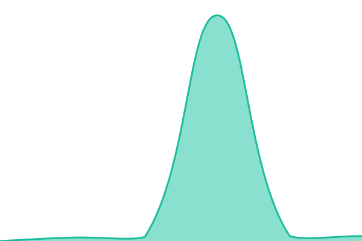

# [📈 Live Status](https://Chili36.github.io/upptime): <!--live status--> **🟩 All systems operational**

This repository contains the open-source uptime monitor and status page for [David Foster](blogg.elakedave.se), powered by [Upptime](https://github.com/upptime/upptime).

With [Upptime](https://upptime.js.org), you can get your own unlimited and free uptime monitor and status page, powered entirely by a GitHub repository. We use [Issues](https://github.com/Chili36/upptime/issues) as incident reports, [Actions](https://github.com/Chili36/upptime/actions) as uptime monitors, and [Pages](https://Chili36.github.io/upptime) for the status page.

<!--start: status pages-->
<!-- This summary is generated by Upptime (https://github.com/upptime/upptime) -->
<!-- Do not edit this manually, your changes will be overwritten -->
<!-- prettier-ignore -->
| URL | Status | History | Response Time | Uptime |
| --- | ------ | ------- | ------------- | ------ |
|  [EU Pesticides API - residue definitions](https://api.datalake.sante.service.ec.europa.eu/sante/pesticides/pesticide-residues?format=json&pesticide_residue_lg=EN&api-version=v3.0) | 🟩 Up | [eu-pesticides-api-residue-definitions.yml](https://github.com/Chili36/upptime/commits/HEAD/history/eu-pesticides-api-residue-definitions.yml) | 

 922ms
     
 | 

<a href="https://Chili36.github.io/upptime/history/eu-pesticides-api-residue-definitions">100.00%</a>
    

|  [EU Pesticides API - active substances](https://api.datalake.sante.service.ec.europa.eu/sante/pesticides/active-substances?format=json&api-version=v3.0) | 🟩 Up | [eu-pesticides-api-active-substances.yml](https://github.com/Chili36/upptime/commits/HEAD/history/eu-pesticides-api-active-substances.yml) | 

 857ms
     
 | 

<a href="https://Chili36.github.io/upptime/history/eu-pesticides-api-active-substances">100.00%</a>
    

<!--end: status pages-->

[**Visit our status website →**](https://Chili36.github.io/upptime)

## 📄 License

- Powered by: [Upptime](https://github.com/upptime/upptime)
- Code: [MIT](./LICENSE) © [Anand Chowdhary](https://anandchowdhary.com)
- Data in the `./history` directory: [Open Database License](https://opendatacommons.org/licenses/odbl/1-0/)
